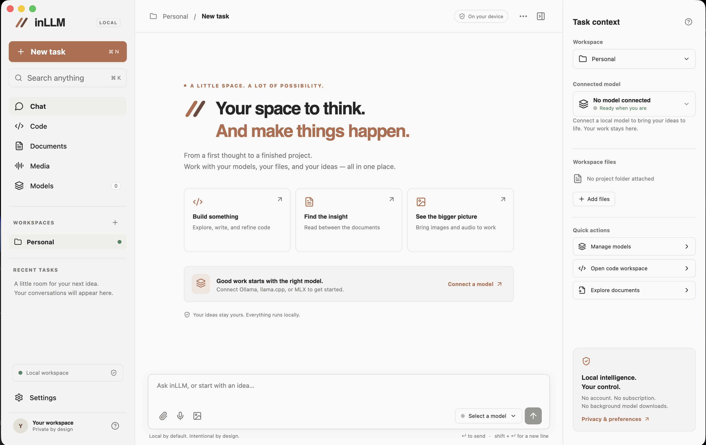
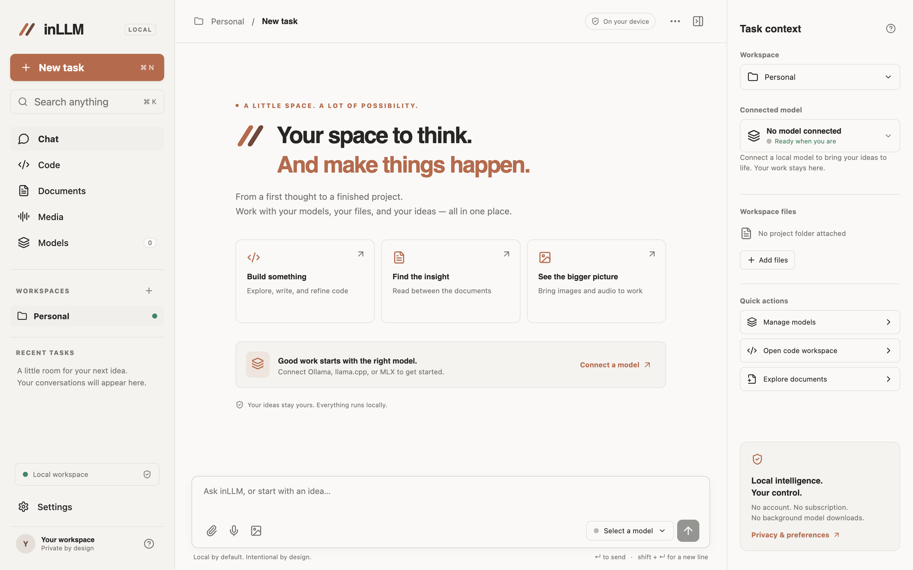

<h1>
  
  inLLM
</h1>


**A unified environment for local AI development and interaction.**

inLLM is an open-source AI workspace designed to bring local language models and multimodal capabilities into a single, cohesive environment. Available as a macOS desktop application and a browser-based interface, it integrates AI-assisted coding, conversational interaction, document analysis, image understanding, and audio processing.

Built around a modular architecture, inLLM supports compatible models through Ollama, llama.cpp, and MLX, allowing users to manage their own models and workflows without relying on a specific provider.

**Developed by Altan Ulas Zohre.**


## Application preview

### macOS desktop application



### Web application



*These 2880 × 1800 screenshots were captured from the running applications with no model installed. They contain neither personal files nor generated AI responses.*

## Workspaces

| Workspace | Capabilities |
| --- | --- |
| **Chat** | Persistent local conversations, streaming provider responses, cancellation, Markdown, attachments, and model selection. No simulated AI replies when a model is unavailable. |
| **Code** | Project explorer, tabbed CodeMirror editor, source search, contextual AI requests, diff previews, approval-based file changes, and bounded test commands. |
| **Documents** | Local PDF, TXT, Markdown, and DOCX text extraction; previews; page and chunk references; and model-ready questions. |
| **Media** | Image previews, vision requests gated by model capabilities, audio upload and recording, installed system voice playback, and supported on-device macOS speech recognition. |
| **Models** | Discovery of Ollama, llama.cpp/GGUF, and MLX runtimes; model import; user-initiated downloads; progress controls; validation; and model selection. |

The macOS and web editions share a **React and TypeScript interface** backed by the same **local Express API**. The desktop application manages the local API lifecycle; the web edition connects through a browser on the same machine. Neither edition requires an installed model merely to open the workspace.

## Requirements

- **Source builds:** Node.js 22.16 or later and pnpm 11.
- **macOS desktop package:** Apple Silicon macOS. MLX runtime supervision is intended for supported Apple Silicon systems.
- **Web edition:** macOS, Windows, or Linux with Node.js.
- **AI inference:** A separately installed compatible Ollama, `llama-server`, or `mlx_lm.server` runtime, plus a supported model.
- **Resources:** Sufficient memory and storage for the chosen model. The Model Manager displays an estimated memory requirement and available disk space.

Model runtimes and model weights are **not installed automatically**.

## Run the web application

```bash
pnpm install
pnpm build
pnpm start
```

Open the **private launch URL** displayed in the terminal. Its URL fragment contains a session token: keep the link private.

The API binds to `127.0.0.1` by default and is not exposed to the local network. Optional environment variables:

| Variable | Purpose |
| --- | --- |
| `INLLM_PORT` | Select a different loopback port. |
| `INLLM_DATA_DIR` | Set a separate application data directory, for example for development. |

For local development:

```bash
pnpm dev
```

The development command uses the most recently built frontend. Rebuild the frontend after changing UI source files, and use the token-bearing URL printed by the backend.

## Build the macOS application

On a supported Mac:

```bash
pnpm install
pnpm build
pnpm package:mac
```

The double-clickable application is generated at:

```text
release/inLLM-darwin-<arch>/inLLM.app
```

The `release/` directory is excluded from Git. The locally built application starts without a model installed.

**Distribution:** This development build is not code-signed or notarized. Public distribution of a macOS binary requires a separate signing and notarization process.

## Connect or download a model

Open **Models** and choose the relevant workflow:

1. **Connect a local runtime.** Use an existing Ollama, llama.cpp, or MLX server bound to a loopback address.
2. **Import a model.** Register an existing GGUF file or compatible MLX snapshot at a user-selected location; imported files remain in place.
3. **Download a supported model.** Review a public Hugging Face repository or an allowed GGUF URL, including available size and license information, before explicitly starting a download.
4. **Pull an Ollama model.** Enter a model name and initiate the pull through an already running Ollama instance.

Managed downloads are stored in a selected model directory **outside** the application bundle and source tree. Supported downloads provide progress reporting and pause/resume controls.

GGUF imports and downloads are checked for a valid container header. MLX snapshots are checked for expected configuration, tokenizer, and safetensors components. Where a suitable checksum is available in the source manifest, SHA-256 validation is performed. The application does not automatically execute remote model code.

A successful file check does **not** guarantee inference compatibility: the selected runtime, model architecture, and hardware must still be compatible. Vision requests are available only when the provider reports the required capability.

> **Validation scope:** No model weights were downloaded during development or testing. Real inference, large-model loading, and remote download performance have not yet been verified across model/runtime combinations.

## Privacy and safety

inLLM is designed for local operation and explicit user control.

- **Local-only API by default:** Requests use a random bearer token, same-origin checks, and loopback host restrictions.
- **Restricted workspace access:** Project file access is scoped to a selected workspace root. Hidden and sensitive files, unsupported file types, and symbolic-link escapes are restricted.
- **Review before changes:** AI-suggested code edits remain proposals until the user reviews and approves a diff. Test commands also require approval and enforce time and output limits.
- **Local data storage:** Conversations and imported content are kept in the operating system's application data directory rather than the source repository.
- **Controlled downloads:** User-initiated model downloads are restricted to supported HTTPS Hugging Face sources or explicit local Ollama pulls, with redirect and size checks.
- **No bundled personal data:** The repository does not include model weights, private documents, conversation histories, or recordings. No account or telemetry service is required.

The browser edition uses the local API for privileged operations; a browser does not have unrestricted filesystem access. Audio and screen-related functionality depend on platform permissions and available local capabilities.

## Architecture

```text
src/          Shared React + TypeScript interface
server/       Local Express API, providers, storage, documents, workspaces
desktop/      Electron shell, native dialogs, macOS speech integration
scripts/      Build, packaging, and privacy checks
tests/        Lightweight synthetic integration tests
docs/assets/  Captures from the running applications
```

- **Frontend:** React, TypeScript, Vite, and CodeMirror.
- **Backend:** Express and modular model-provider adapters.
- **Storage:** `sql.js` with a locally persisted SQLite database.
- **Inference adapters:** Ollama's streaming API and compatible local endpoints exposed by llama.cpp and MLX.
- **Desktop integration:** Electron manages native dialogs and the local backend lifecycle.

## Development checks

```bash
pnpm typecheck
pnpm test
pnpm build
pnpm check:privacy
```

Lightweight synthetic tests cover API token enforcement, startup without a model, approval before file writes, document extraction, GGUF header validation, and model download URL restrictions. The checks do not require model weights, training, benchmarks, or large datasets.

## Project status

The web edition and packaged macOS application have been opened locally without a model installed. The application provides a model-ready interface and integration architecture; this should not be interpreted as verification of every third-party model or runtime combination.

Native macOS speech recognition depends on operating-system support and permissions. Browser speech recognition is not automatically routed to a cloud service.

---

**inLLM** · Developed by **Altan Ulas Zohre**
